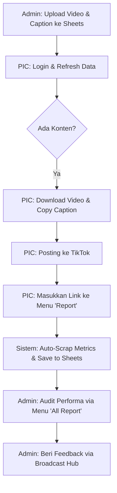

# 📘 PANDUAN PENGGUNAAN: BEATSTORIA CONTENT MANAGER (V2.1)

Aplikasi ini dirancang untuk orkestrasi konten profesional, menghubungkan tim PIC lapangan dengan Admin melalui sinkronisasi data real-time dengan Google Sheets.

---

## 🔐 1. AKSES & OTENTIKASI

### Flow Login:
1.  **Pilih Identitas**: Klik pada kartu nama Anda (PIC) atau pilih "Admin" di bagian bawah grid.
2.  **Input Password**: Masukkan password rahasia sesuai kredensial masing-masing.
3.  **Haptic & Audio**: Sistem akan memberikan nada "Cring" (Sukses) atau Getaran/Nada Error jika akses ditolak.

---

## 👤 2. MODUL PIC (PERSON IN CHARGE)

Modul ini difokuskan pada eksekusi tugas harian dan pelaporan link postingan.

### A. Dashboard Utama (Home)
*   **KPI Ring**: Melihat persentase penyelesaian tugas hari ini secara visual.
*   **Ready Alert**: Notifikasi otomatis jika ada video baru yang siap didownload dari Admin.
*   **Akun Grid**: Klik pada akun tertentu untuk langsung melihat daftar tugas posting akun tersebut.

### B. Pengambilan Konten (Posts)
*   **Download Video**: Klik tombol **📥 Download Video** untuk mengunduh file MP4 langsung ke perangkat (tanpa buka tab baru).
*   **Copy Caption**: Klik tombol **📋 Copy Caption** untuk menyalin teks deskripsi konten secara instan.
*   **Status READY**: Jika konten memiliki video siap download, label **🎬 READY** akan muncul berdenyut.

### C. Pelaporan Harian (Daily Report)
*   **Akses**: Pilih menu **"Report"** di navigasi bawah.
*   **Input Link**: Masukkan link postingan TikTok ke dalam 6 slot yang tersedia per akun.
*   **Validation**: Sistem otomatis mengecek link ganda dan memperingatkan jika ada tanggal yang terlewati (*Skipped Date Warning*).
*   **Save**: Klik **🚀 Simpan Laporan Hari Ini** untuk sinkronisasi ke Google Sheets pusat.

---

## 👑 3. MODUL ADMIN (CONTROL & MONITORING)

Modul ini khusus untuk oversight global dan audit performa.

### A. Advanced Admin Report (All Report)
*   **Modul Kalender**: Pilih rentang waktu (Misal: 01 Mei s/d 10 Mei) untuk melihat performa akumulatif.
*   **Infographic Stats**: Melihat total Views, Likes, dan Comments dari seluruh PIC dalam rentang waktu terpilih secara visual.
*   **Audit Link Detail**: 
    *   Melihat daftar baris-per-baris setiap postingan yang dilakukan tim.
    *   Klik **🌐 Browse TikTok** untuk memverifikasi langsung postingan di platform TikTok.
    *   Setiap baris menampilkan data performa terkini (Live Views/Likes).

### B. Panel Monitoring (Admin Tab)
*   **PIC Overview**: Pantau progress persentase setiap PIC secara real-time.
*   **Activity Log**: Melihat log aktivitas sistem (siapa yang login, kapan link disimpan, dll).
*   **Broadcast Hub**: Mengirim pesan instruksi atau arahan strategis ke seluruh tim secara instan.

---

## 🛠️ 4. FLOW FRAME (ALUR KERJA)

---

## 💡 TIPS PROFESIONAL
1.  **Refresh Berkala**: Gunakan tombol refresh (ikon putar) di pojok kanan atas untuk mendapatkan instruksi terbaru dari Admin.
2.  **Hard Refresh**: Jika aplikasi terasa berat, lakukan tarik layar ke bawah atau tekan `Ctrl+F5` untuk membersihkan cache.
3.  **Case Sensitive**: Pastikan link TikTok diawali dengan `https://` agar sistem scraper bisa bekerja secara otomatis.

---
*Developed by Beatstoria AI - Professional Content Orchestration Ecosystem*
